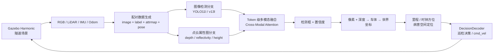

# 多模态基础设施病害检测与定位系统

面向地铁/隧道巡检场景的多模态病害检测与空间定位系统。项目将 **RGB 图像、LiDAR 点云属性图、车辆位姿与 ROS 2 仿真** 串成完整链路：数据生成 → 2D 检测 → 图像/点云融合 → 像素到隧道坐标映射 → 决策与闭环控制。

> 本仓库是原项目散落模块的统一整理版，保留训练、推理、定位、仿真和评估源码；数据集、模型权重、训练输出与虚拟环境不纳入 Git。

## 系统链路



## 模块

| 目录 | 内容 |
|---|---|
| `inspection_robot/` | ROS 2 Humble + Gazebo Harmonic 巡检小车、URDF、传感器桥接、数据生成、融合模型、像素到世界坐标与定位验证 |
| `tunnel_crack_fusion/` | RGB + LiDAR attrmap 的 token 级交叉注意力融合、A/B 消融、训练与统一口径评测 |
| `tunnel_crack_mm/` | 图像单支 / 融合 / 无点云分支对比、Range-QFL、检测结果导出、离线闭环回放与实时推理节点 |
| `detection_2d/` | 土建 / 轨道 / 设备三领域 2D 检测、SegFormer + LoRA、YOLO 训练、标注工具与像素到空间语义映射 |
| `fusion_early/` | 早期融合版本、三领域分支训练、置信度搜索、融合闭环与消融对照代码 |
| `results/` | 已保留的实测指标、训练曲线和闭环可视化，不含权重 |
| `data/` | 数据集目录约定（实际数据需自行放置） |

## 核心技术

- **多模态融合**：YOLO11l 三尺度 neck 输出 8,400 个图像 token；LiDAR 属性图经 CNN 编码为 3,600 个点云 token；通过交叉注意力与动态权重完成 token 级融合。
- **2D/3D 空间定位**：检测框内深度中值 → 相机坐标系 → 车体坐标系 → 世界坐标系，输出病害相对里程与时钟方位。
- **三领域病害覆盖**：土建（裂缝、渗漏、管片掉块）、轨道（扣件缺失、松动、断裂）、设备（异物入侵、支架状态）。
- **仿真与闭环**：ROS 2/Gazebo 传感器仿真、录制配对数据、离线闭环回放和在线 `cmd_vel` 决策节点。
- **可复现实验**：固定评测口径、A/B 消融、bootstrap 置信区间、Range-QFL 分桶召回与故障诊断脚本。

## 实测结果

以下数字均保留在 `results/` 中，详细口径见各子模块 README。

| 实验 | 结果 |
|---|---|
| 三领域 2D 检测（配套检测分支） | 病害类 P@0.93 / R@0.98 |
| 融合 A/B：RGB vs RGB+PointCloud | 连续 AP **0.7541 → 0.7736**；点云支主要降低假阳性 |
| 融合增益 bootstrap | Δ=+0.0194，95% CI 跨 0，本实验规模下尚不能宣称显著增益 |
| Range-QFL 真留出集 | 连续 AP **0.8869 → 0.9152**，最优工作点置信度从 0.0058 提升到 0.1146 |
| 离线闭环回放 | 2,568 步、35.86 m；840 个检查步，巡航步占比 24.4% |

> 融合实验的结论以置信区间为准：当前结果支持“点云倾向减少误检”，但不支持“已经证明稳定显著提升”。

## 快速开始

### 1. 仿真与定位

环境要求：Ubuntu 22.04、ROS 2 Humble、Gazebo Harmonic、已编译的 `ros_gz`。

```bash
cd inspection_robot
colcon build --symlink-install
source install/setup.bash
ros2 launch inspection_robot inspection_robot.launch.py headless:=true use_rviz:=false
```

外部 `ros_gz` 工作空间可通过环境变量指定：

```bash
export ROS_GZ_WS=$HOME/ros_gz_ws
source setup.sh
```

### 2. 多模态融合训练

```bash
python3 -m venv .venv
source .venv/bin/activate
pip install -r tunnel_crack_fusion/requirements.txt
cd tunnel_crack_fusion
python -m tunnel_tri.train --modalities rgb+pc --epochs 60 --batch 8 --out runs/rgb_pc
python -m tunnel_tri.evaluate --ckpt runs/rgb_pc/last.pt
```

### 3. 分支对比与闭环回放

```bash
cd tunnel_crack_mm
python compare_branches.py
python eval_qfl.py
python run_closed_loop_crack.py \
  --det detections_crack.json \
  --poses ../inspection_robot/data_gen/output_crack_big/poses \
  --out runs/closed_loop.json
```

## 数据与权重

为避免仓库膨胀，以下内容不入库：

- 配对数据：`data/output_crack_big/{images,labels,attrmaps,poses}`
- 2D 检测权重：`weights/yolo11l.pt`
- 融合权重：`weights/assist_crack.pt`、`weights/assist_crack_qfl.pt`
- 位姿编码器：`weights/pose_mlp_tunnel.pt`

数据格式与放置方式见 `data/README.md`，权重说明见 `weights/README.md`。

## 目录速览

```text
MultiModalityDetectAndLocationSystem/
├── README.md
├── data/                       # 数据集约定（不存放实际数据）
├── weights/                    # 权重说明（不存放实际权重）
├── results/                    # 实测指标与闭环可视化
├── inspection_robot/           # ROS 2 / Gazebo / 定位 / 融合
├── tunnel_crack_fusion/        # 多模态融合训练与评测
├── tunnel_crack_mm/            # 分支对比 / 闭环回放 / 实时推理
├── detection_2d/               # 三领域检测 / 分割 / 标注 / 空间映射
└── fusion_early/               # 早期融合 / 分支训练 / 闭环对照
```

## 说明

- 三领域 2D 检测指标来自配套检测分支；本仓库保留数据生成、融合与定位链路。
- 训练和推理脚本默认使用相对路径，可用 `IR_ROOT`、`YOLO11L_CKPT`、`POSE_CKPT`、`IMG_CKPT` 等环境变量覆盖。
- 公开仓库不包含任何服务器地址、密钥或私有数据。
