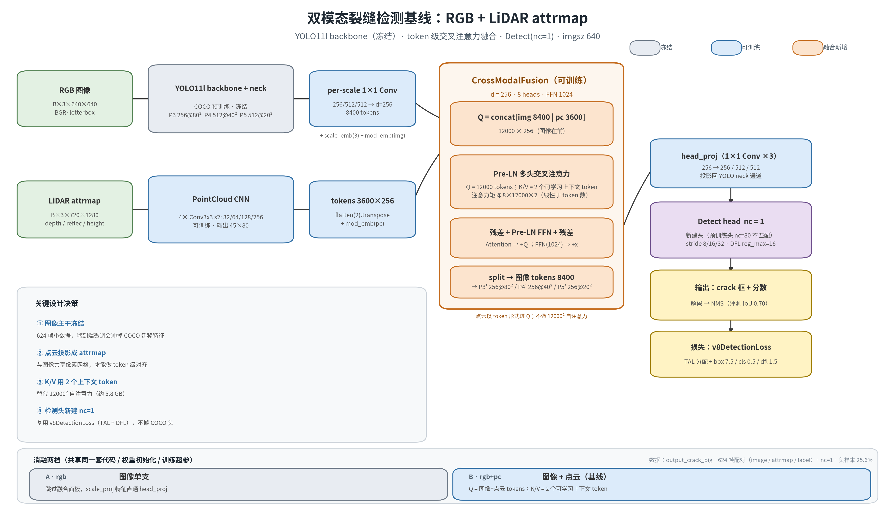

# tunnel_tri_fusion — 隧道裂缝双模态检测基线

图像（RGB）+ 点云（LiDAR attrmap）**token 级特征融合**的裂缝检测基线。
主干用 YOLO11l（COCO 预训练、冻结），融合为交叉注意力，检测头新建 `nc=1`。

本仓库由 `~/workspace/inspection_robot/fusion/` + `~/workspace/tunnel_crack_mm/` 的已验证实现抽出，
改为**自包含、无 ROS 依赖**，便于整体 rsync 到训练服务器。

## 模型结构



| 支 | 输入 | 编码器 | 输出 token |
|---|---|---|---|
| 图像 | B×3×640×640 BGR | YOLO11l backbone+neck（冻结）+ per-scale 1×1 Conv | 8400×256 |
| 点云 | B×3×720×1280（depth/reflec/height） | 4×Conv3x3 s2 CNN（可训） | 3600×256 |

融合：`Q = concat[img, pc]`（12000×256）→ Pre-LN 多头交叉注意力
（K/V = 2 个可学习上下文 token）→ 残差 + FFN → 拆回图像 tokens → reshape 三尺度
→ `head_proj` 投回 256/512/512 → `Detect(nc=1)`。

训练时融合按 token 分块（默认 2048）+ 梯度检查点：每个 query 只 attend 固定的
2 个 context token、FFN 逐 token 独立，分块与整批**严格等价**（`tests/test_fusion_chunk.py`
断言前向 Δ=0、梯度相对误差 <1e-5），只换内存。在只剩 ~3.4 GB 可用显存的卡上，
整批 batch 8 会 OOM 在 FFN，分块后可训（代价是每 epoch 26 s → 46 s）。

## 消融两档

| 档 | `--modalities` | 融合方式 |
|---|---|---|
| A | `rgb` | 跳过融合面板，`scale_proj` 特征直通 `head_proj` |
| B | `rgb+pc` | Q=图像+点云 tokens，K/V=2 个可学习上下文 token（**基线**） |

两档共享同一套代码、权重初始化与训练超参，只切换开关。

## 为什么不做位姿 / 时序（已决策，2026-10-27）

- **位姿**：静态隧道、无全局地图先验，仿真 odom 只编码"车在哪"，与裂缝外观无关；
  点云辅助此前实测已无增益（0.9051 vs 0.9049），位姿只会更弱。数据仍保留 `poses/`，不参与训练。
- **时序**：单帧连续插值 AP 已 0.978，接近饱和；624 帧是连续行驶序列，随机划分本身存在帧泄漏，
  不先修正评测协议，时序增益无法归因。更划算的时序方案是后处理级跟踪投票，不改模型。
- 架构上 K/V 槽位保留（2 个 token），将来接时序只需换条件编码器，融合结构不动。

## 数据

`~/workspace/inspection_robot/data_gen/output_crack_big`（624 帧配对）：

```
images/000000.jpg      1280×720
labels/000000.txt      YOLO 归一化，nc=1（crack），负样本 25.6%
attrmaps/000000.npz    depth / reflec / height / mask（各 720×1280）
poses/000000.json      odom（本基线不使用）
```

`mask` 通道已在 npz 里但基线沿用 3 通道，4 通道版本留作后续实验。

## 目录

```
tunnel_tri/
  config.py      路径/超参常量（全部可被 CLI 覆盖）
  encoders.py    ImageEncoder / PointCloudEncoder
  fusion.py      CrossModalFusion
  model.py       DualModalYOLO（两档消融开关）
  data.py        配对样本装载 / collate / letterbox
  loss.py        v8DetectionLoss 容器
  train.py       训练入口
  evaluate.py    统一尺子评测（连续插值 AP + VOC11 + 最优工作点）
tools/
  draw_arch.py   生成结构图
scripts/
  sync_to_server.sh   rsync 数据与代码到训练服务器
docs/figures/    结构图
```

## 运行

```bash
# 本地/服务器通用（数据与权重路径可用 --data / --yolo 或环境变量覆盖）
python3 -m tunnel_tri.train --modalities rgb+pc --epochs 60 --batch 8 --out runs/rgb_pc
python3 -m tunnel_tri.evaluate --ckpt runs/rgb_pc/last.pt

# 两档一起跑（服务器）
bash scripts/run_baseline.sh
```

数据放到 `data/output_crack_big/`，主干权重放到 `weights/yolo11l.pt`（缺省时回落到本机原始路径）。

## 评测口径（写死，避免再犯）

- **同一把尺子**比较两档：连续插值 AP + VOC 11 点 AP 都报，NMS IoU **0.70**。
- 融合分支的**分数尺度与图像单支不同**，必须单独测最优工作点 `opt_thresh`；不得用 AP 反推默认阈值可用。
- 训练日志中 `box=0.000 cls=大数` 的 iter 是全背景 batch，正常。

## 基线结果（2026-10-28）

`weights/yolo11l.pt` COCO 主干冻结，600 帧训练（前 500）/ 124 帧真留出（尾部 500–623），
batch 8、60 epoch、AdamW、Cosine；评测同一把尺子（NMS IoU 0.70、匹配 IoU 0.5、conf≥0.001）。

| 档 | 连续 AP | VOC11 AP | n_det | TP | 最优工作点 th | P | R |
|---|---|---|---|---|---|---|---|
| A `rgb` | 0.7541 | 0.7302 | 3023 | 459 | 0.196 | 0.770 | 0.716 |
| B `rgb+pc` | **0.7736** | **0.7376** | 2533 | 463 | 0.235 | **0.793** | **0.718** |
| Δ (B−A) | +0.0195 | +0.0074 | −490 | +4 | | +0.023 | +0.002 |

点云支的增益主要体现在**压假阳性**：检出少 16% 而命中多 4 个，P +0.023、R 基本持平。

**但这个 +0.0195 与 0 区分不开**（`tools/ab_bootstrap.py`，2000 次重采样）：

| 指标 | Δ (B−A) | 95% CI（按帧） | 95% CI（块=10 帧） | P(Δ>0) |
|---|---|---|---|---|
| 连续 AP | +0.0194 | [−0.0130, +0.0513] | [−0.0184, +0.0680] | 0.85–0.88 |
| VOC11 AP | +0.0074 | [−0.0220, +0.0489] | [−0.0253, +0.0641] | 0.80 |

区间跨 0。块重采样比按帧更宽，符合预期（相邻帧相关，按帧独立重采样会低估方差）。
三个检查点上 B 档全部领先（+0.035 / +0.030 / +0.020），方向一致；但同一条训练轨迹
的检查点不构成独立样本，且只有单种子、124 帧验证集。**结论应表述为「点云支倾向于小幅
降假阳性，本实验规模下无法与零增益区分」**，不能写成"点云带来 +0.02 AP"。

要把这条做实，最小代价是多种子重复（每档 3 seed）而不是延长 epoch。

留出段比训练段更难：空帧 31% vs 23%、GT 4.2/帧 vs 5.8/帧，这是 AP 低于历史随机划分
（0.95 量级）的主要原因，不是代码回归。快照趋势 rgb 0.737→0.749→0.754 单调上升、
rgb+pc 0.772→0.779→0.774 在 40–60 之间回落，说明 B 档收敛更早。

## 当前状态

- [x] 项目骨架
- [x] 模型结构图 `docs/figures/model_arch.png`（`python3 tools/draw_arch.py` 可复现）
- [x] 模型/数据/训练/评测代码（本地 CPU 冒烟通过）
- [x] 服务器 A/B 两档训练 + 评测完成（连续 AP 0.7541 → 0.7736）
- [x] 差值 bootstrap 区间：Δ=+0.0194，95%CI 跨 0 ⇒ 不能宣称点云显著增益
- [ ] 多种子重复（每档 3 seed）才能把增益做实

## 训练服务器

代码与数据通过 `scripts/sync_to_server.sh` 推送；密码不入库，运行时交互输入或走 ssh-agent。
